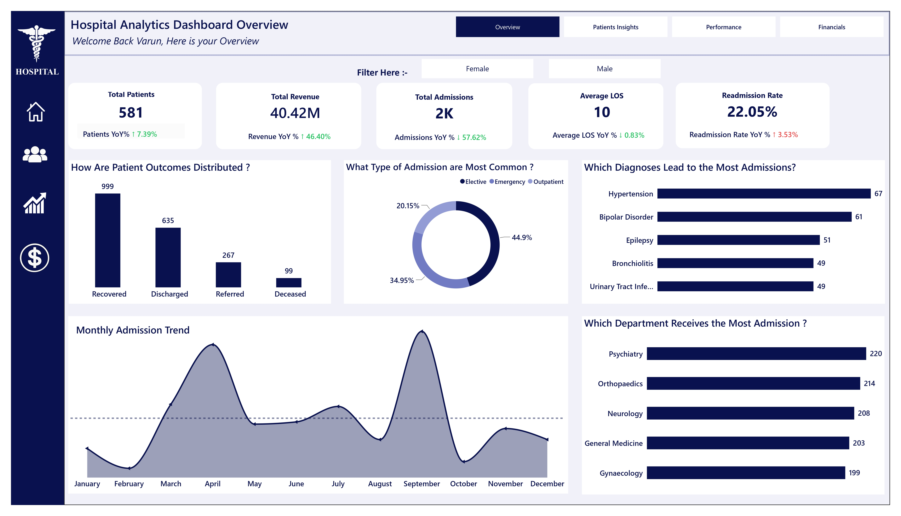
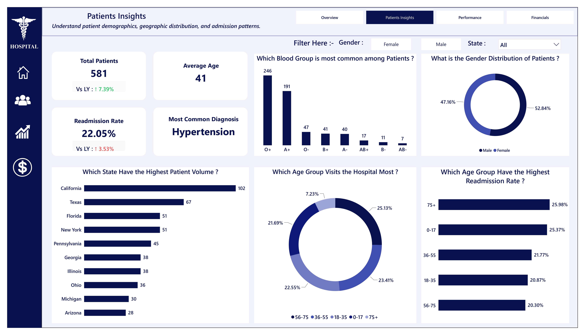
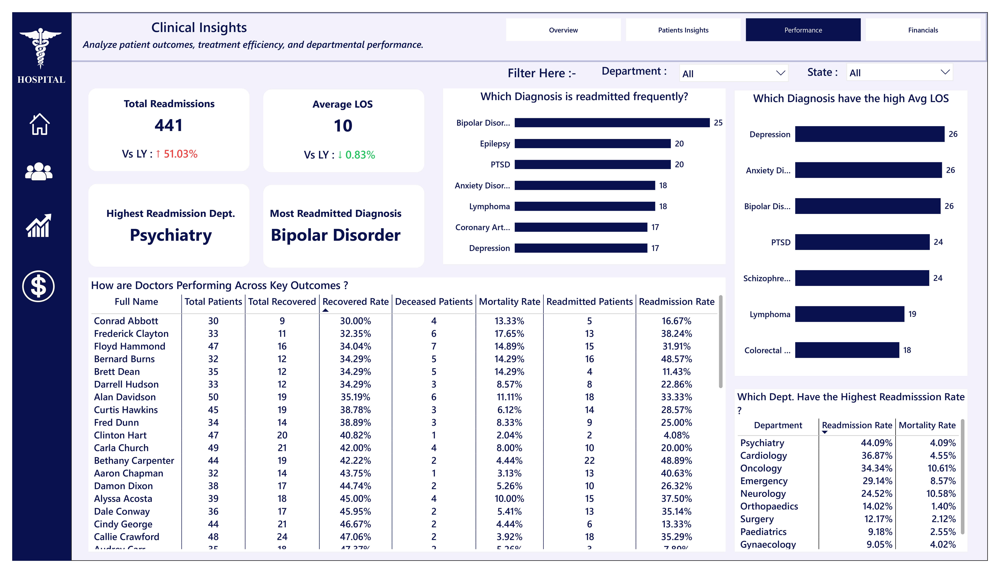
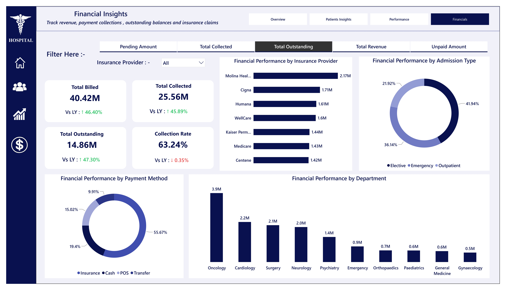

# 🏥 Hospital Analytics Dashboard  Power BI

## 📌 Project Overview

This project focuses on analysing hospital admission records using Microsoft Power BI to identify opportunities to improve patient outcomes, optimise hospital operations, and strengthen financial performance.

The dashboard provides insights into patient admissions, readmission rates, length of stay (LOS), clinical performance, revenue collection, and outstanding insurance claims.

The goal is to transform hospital data into actionable insights that support data-driven decision-making.

## 🎯 Business Problem

The hospital faces several operational and financial challenges

- High patient readmission rates.
- Increasing or prolonged length of stay, potentially increasing operational costs.
- Differences in clinical performance across departments.
- Outstanding, unpaid, and pending insurance claims affecting cash flow.
- Limited visibility into the factors contributing to these challenges.

## 🎯 Project Objectives

- Analyse hospital admissions and patient trends.
- Monitor readmission rates and average length of stay.
- Compare clinical performance across departments and diagnoses.
- Evaluate billed revenue, collections, and outstanding balances.
- Identify areas for operational improvement and revenue recovery.
- Present findings through an interactive Power BI dashboard.

## 🛠️ Tools & Technologies

- Microsoft Power BI — Dashboard development and reporting
- DAX — Measures, KPIs, and calculations
- Power Query — Data transformation and preparation
- Data Modelling — Organising data and relationships
- Data Visualisation — Communicating trends and business insights
- Business Intelligence — Supporting data-driven decisions

## 📊 Dashboard Structure

The dashboard consists of four analytical pages.

### 1. Overview

Provides a high-level view of hospital performance through key performance indicators (KPIs).

Key metrics include
- Total Patients
- Total Admissions
- Readmission Rate
- Average Length of Stay
- Total Billed Revenue

### 2. Patient Insights

Explores patient characteristics and admission patterns to understand how hospital services are being utilised.

Key areas
- Patient demographics
- Admission patterns
- Patient distribution
- Admission-related trends

### 3. Clinical Insights

Evaluates clinical and operational performance to identify areas requiring further investigation.

Key areas
- Department-wise performance
- Patient readmissions
- Length-of-stay analysis
- Diagnosis-related trends
- Patient outcome patterns, where available

### 4. Financial Insights

Examines hospital revenue and insurance payment performance to identify opportunities to improve collections.

Key areas
- Total Billed Revenue
- Total Collected Revenue
- Outstanding Balances
- Unpaid and Pending Claims
- Insurance-related financial trends

## 📈 Key Performance Indicators

The following metrics were highlighted in the project dashboard

 KPI  Reported Value 
------
 Total Patients  581 
 Total Admissions  Approximately 2,000 
 Readmission Rate  22.05% 
 Average Length of Stay  Approximately 10 days 
 Total Billed Revenue  $40.42 million 


## 💡 Key Business Recommendations

Based on the analytical focus of the dashboard, the following actions are recommended for further evaluation

### 1. Reduce Readmissions
Prioritise structured post-discharge follow-up for patients and departments with higher readmission rates, particularly Psychiatry if supported by the analysis.

### 2. Review Length of Stay
Investigate departments and patient groups with longer stays. Review care pathways and consider stepped-care approaches where clinically appropriate.

### 3. Strengthen Revenue Recovery
Monitor outstanding insurance balances, identify providers with substantial unpaid claims, and improve claim follow-up and reconciliation processes.

## 📷 Dashboard Preview


Overview


Patient Insights


Clinical Insights


Financial Insights



## 📁 Repository Structure

```text
Hospital-Analytics-PowerBI
│
├── README.md
├── Hospital_Dashboard.pbix
└── Screenshots
    ├── overview.png
    ├── patient-insights.png
    ├── clinical-insights.png
    └── financial-insights.png
```

## 🚀 Skills Demonstrated

- Data cleaning and transformation
- Data modelling
- DAX calculations and KPI development
- Interactive dashboard design
- Business performance analysis
- Clinical and financial data analysis
- Insight generation and business recommendations
- Data storytelling and visualisation

## 🔍 Project Outcome

The project brings hospital operational, clinical, and financial indicators into a unified reporting experience.

It demonstrates how Power BI can help stakeholders monitor performance, investigate potential operational challenges, and identify opportunities to improve patient care processes and financial recovery.

The recommendations are intended to support further investigation and should be validated against clinical context and the underlying data before implementation.

## 👨‍💻 Author

Varun Gupta  
M.Sc. Statistics Graduate  || Data Analyst

Technical Skills Power BI  DAX  SQL  Python  Excel  Data Analytics

- LinkedIn : www.linkedin.com/in/varun-gupta-statistics
---

⭐ If you find this project useful, feel free to explore the repository and share your feedback.

